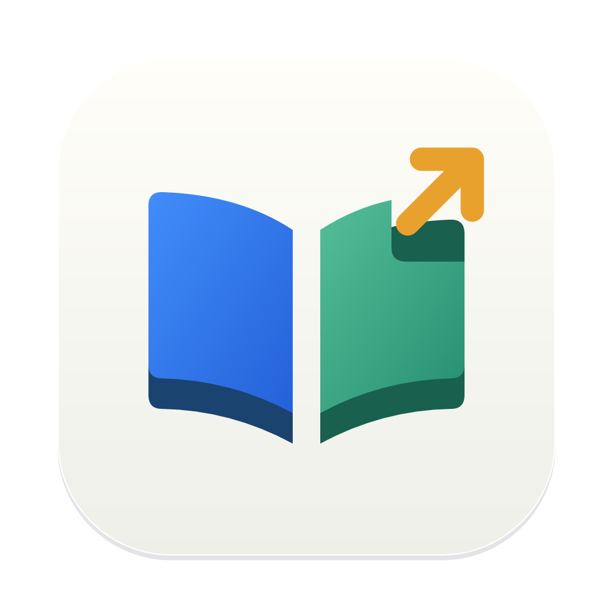
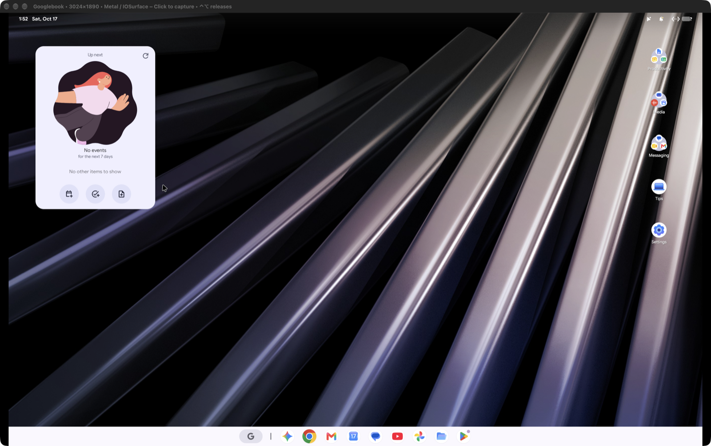

# Try Googlebook OS



An experimental Googlebook OS VM for Apple Silicon Macs, based on
[skylartaylor/gbos-vm](https://github.com/skylartaylor/gbos-vm).



The ARM64 desktop has booted on an M4 Pro with 24 GB RAM and macOS 27.0.1.
This fork adds a compact native window header, a captured-pointer speed control,
and a fix for control-socket paths in deeply nested folders.

## Install with Homebrew

```sh
brew tap 4nkitd/tap
brew install --cask try-googlebook-os
open -a "Try Googlebook OS"
```

Or download the ARM64 DMG from [Releases](https://github.com/4nkitd/try-googlebook-os/releases),
drag **Try Googlebook OS.app** to Applications and open it.

**The download is a compiled setup launcher, not a preinstalled OS image.** First launch
offers to open setup in Terminal. Setup downloads the pinned Google recovery and UTM
components from their original providers, builds the compatibility runtime locally,
and opens the VM. Later launches open the prepared VM.

Requirements:

- Apple Silicon, macOS 26 or newer. Tested here on macOS 27.0.1, not Intel.
- At least 16 GB RAM and 60 GB free disk during setup.
- Homebrew, `uv` and Xcode command line tools. The cask installs `uv`.
- Android SDK/NDK and a JDK. Setup checks for them and offers to install missing pieces;
  Google SDK licences require your acceptance.
- About 9 GB of downloads, plus any missing developer tools.

The launcher is ad-hoc signed, **not notarized**. If Gatekeeper blocks it, review the
download's provenance and use macOS System Settings → Privacy & Security to approve it.
Do not disable Gatekeeper globally.

VM files live at `~/.local/share/try-googlebook-os/work`. Removing the cask does not delete
the VM or its data. `GOOGLEBOOK_WORK` can select a different work directory for source tools.
No repartitioning or administrator-level QEMU execution is part of the release.

## What works and what is unfinished

Verified locally:

- ARM64 guest boot using QEMU's Hypervisor.framework backend.
- Desktop rendering through the patched VirGL/Venus/MoltenVK stack.
- Guest status, density changes and shutdown over the control channel.
- Compact header layout, measured at 32 points instead of 52 in the native fixture.
- Compiled setup launcher and non-destructive setup checks.

Still experimental or unavailable:

- Mouse feel needs user acceptance. The speed slider affects captured mode only.
- Clipboard support is text-only and incomplete. Captured-mode Cmd-V and copying out need work.
- Audio, fullscreen transitions and long sessions have not passed a comprehensive acceptance suite.
- **Physical USB, real Bluetooth and camera startup are disabled in this alpha.** Research
  prototypes remain in the source, but they lack hardware validation and a safe capture design.
- Upstream reports a 60 fps limit and possible WebGL flat-shading errors.
- The absent-hardware Trusty service still crash-loops. CPU and storage reductions remain planned work.

## Controls

| Control | Action |
| --- | --- |
| Header pointer icon | Choose captured, Android cursor or Mac cursor mode |
| Header gear / Command-comma | Settings |
| Control-Command-F | Full screen |
| Control-Option | Release a captured mouse |
| Control-Command-M | Cycle pointer mode |
| Control-Command-R | Restart a VM owned by the viewer |

The normal viewer asks Android to shut down when closed. Save guest work first.

## Build from source

```sh
git clone https://github.com/4nkitd/try-googlebook-os.git
cd try-googlebook-os
./install.sh
open "work/host/Googlebook VM.app"
```

Stop the VM before rebuilding. `update-image.sh` refreshes the system image while preserving
userdata and retaining a backup; back up important data yourself before experimenting.
Nothing in setup automatically updates an existing disk.

```sh
uv run -m unittest discover -s tests -p 'test_*.py' -v
uv run --python 3.12 distribution/package.py
```

Packaging requires a clean committed tree and macOS. It produces an ARM64 setup-launcher
DMG, a source archive and SHA-256 checksums under `dist/<version>/`.

The icon's vector source is `assets/AppIcon.svg`. Regenerate the PNG and macOS icon with
`uv run --with pillow --with resvg-py assets/make_icon.py`.

## Security and redistribution

This is not a verified Googlebook. The modified vendor partition lacks stock verified-boot
trust, and KeyMint/Gatekeeper use software instead of hardware-backed keys. Use a test
account rather than sensitive personal or work credentials.

The current pointer/clipboard helper and optional simulated Bluetooth radio assume a trusted
local Mac. Their loopback protocols are not a multi-user isolation boundary. The token can
be visible to local processes. Do not use this alpha on a shared, untrusted Mac.

Googlebook OS is proprietary. Releases contain **no Google recovery-derived images, user
disks, accounts, logs or UTM binaries**. They contain our small native setup executable,
compatibility source, icon and documentation. Google and UTM downloads are checked against
the pinned SHA-256 values in `lib.sh`.

## Credits and licence

The VM engine and guest adaptation come from [gbos-vm](https://github.com/skylartaylor/gbos-vm).
It builds on UTM, QEMU, Mesa, MoltenVK, CocoaSpice and Android Cuttlefish. Original copyright
notices are retained. See [LICENSE](LICENSE); the CocoaSpice patch retains Apache-2.0 terms.
This project is independent of Google, Dell, UTM and the upstream authors.

[Roadmap](docs/ROADMAP.md) · [Performance measurements](docs/PERFORMANCE.md) ·
[Feature parity](docs/parity-with-try-omarchy.md) · [USB/Bluetooth research status](docs/usb-passthrough.md)
